<!-- Made by BUSY Bar Emulator from catalog.json. Edit it freely: once you change it, it is yours and is not made again. -->

# spot bar

it shows what you are playing

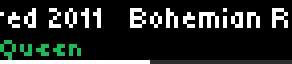
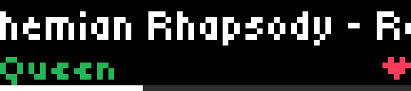
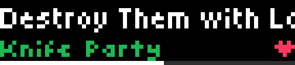
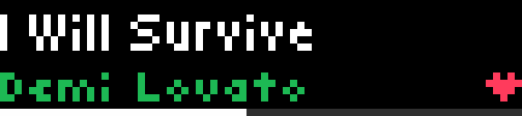

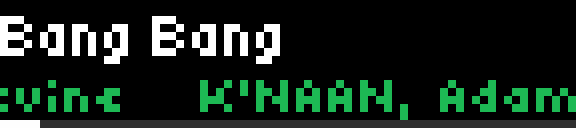
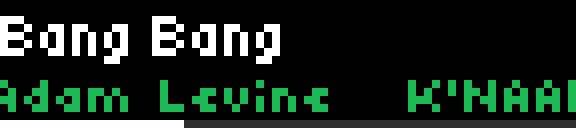
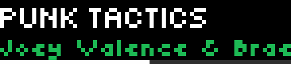
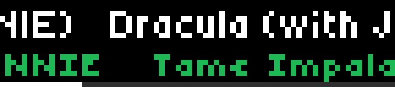
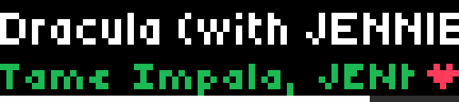
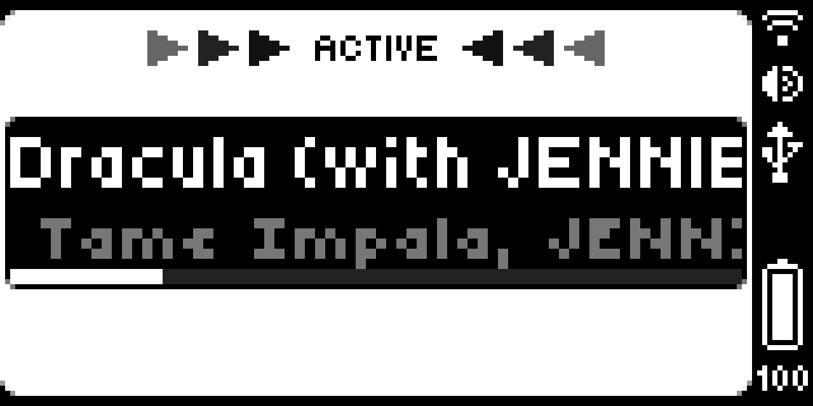
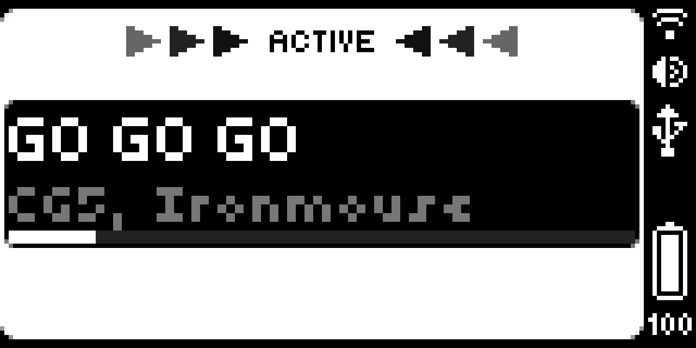
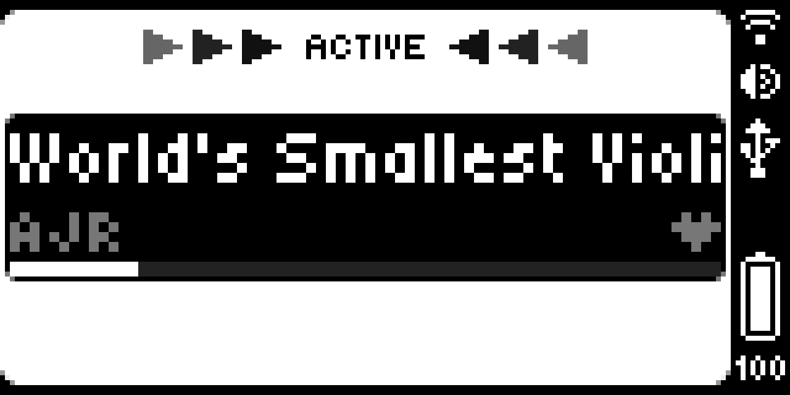

## How to use

- **Start**: Play or pause Spotify
- **Wheel turn**: Next or previous song
- **Wheel press**: Add the song to Liked Songs, or remove it
- **Back**: Close spot bar

## Settings

Change them in the BUSY Bar's local web interface.

- **Spotify Client ID**
- **Spotify Client Secret**
- **Spotify Refresh Token**
- **Access Token (optional, expires in 1 h)**

## Build and install

```sh
npm ci
npm run build         # dist/app.njarvis9516-sys.spot_bar.tgz
npm run app:install   # on a BUSY Bar connected over USB
```

Or open the folder in BUSY Bar Emulator and press Refresh.

Made for [BUSY Bar](https://busy.app).
